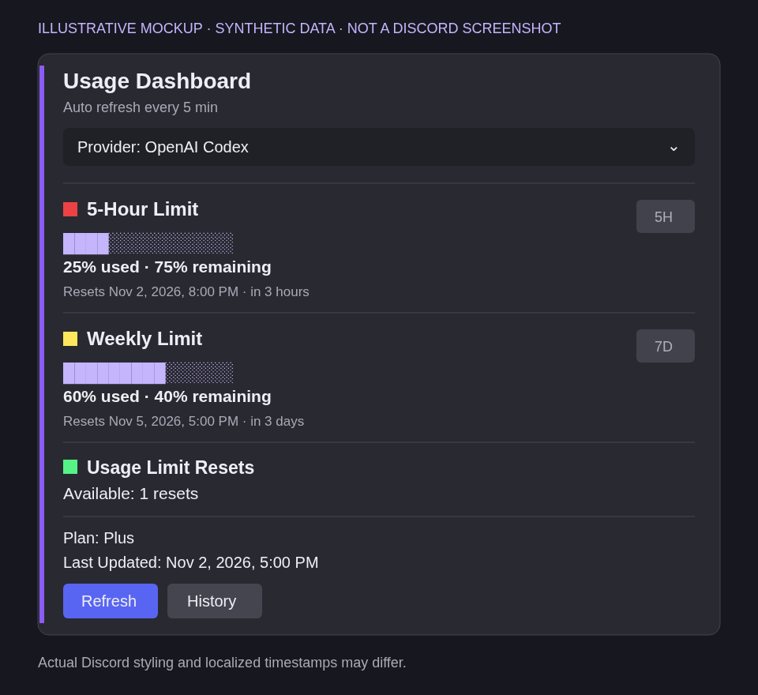
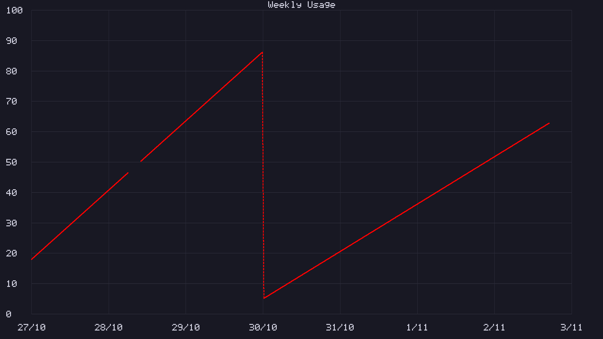

# Codex Usage Dashboard

**English** | [ภาษาไทย](README.th.md)

A self-hosted Discord Components V2 dashboard for OpenAI Codex usage. It reads usage through an existing [Hermes Agent](https://github.com/NousResearch/hermes-agent) installation and updates one pinned Discord message.

## Preview

### Main dashboard



**Illustrative mockup, not a Discord screenshot.** All values and dates are synthetic. Actual Discord styling and localized timestamps may differ. The provider selector, quota sections and Refresh/History controls reflect the current UI.

### Weekly history



**Synthetic data rendered by the actual project renderer**, not real account history. This example includes an ordinary missing-data gap, a confirmed-reset interpolation bridge, and blank future time. History appears in a private ephemeral reply with `← Previous 7 days` and `Next 7 days →` controls (not included in this chart image). Calendar boundaries use **Asia/Bangkok**; UI and chart labels remain English in both language guides.

## Features

- Native Discord Components V2 dashboard with 5-hour and weekly quota windows
- Provider selector prepared for future providers; OpenAI Codex is the only connected provider
- Silent manual refresh and automatic refresh every five minutes
- Private, ephemeral seven-day usage history rendered locally as a deterministic 1920×1080 PNG
- Provider- and account-scoped SQLite history with 90-day logical retention
- Exact message, channel and user authorization for interactions
- Read-only usage adapter: no reset, redemption or quota-consuming endpoint exists in this public package
- No external chart service, analytics or telemetry

## Requirements

- Linux or another system that can keep a Node.js process running
- Node.js 22.13 or newer (`node:sqlite` is required)
- A working `hermes` command with the `openai-codex` provider authenticated
- A Discord application with a bot
- A normal Discord guild text channel

Verify the required usage source before installing:

```bash
hermes usage --provider openai-codex --json
```

Hermes installation and provider setup are documented at <https://hermes-agent.nousresearch.com/docs/>.

## Discord bot setup

1. Create a Discord application and bot, or use a bot whose token Hermes already stores.
2. Invite the bot with the `bot` scope.
3. Grant it View Channel, Send Messages, Read Message History and Pin Messages (or Manage Messages where Discord exposes pinning through it).
4. Leave the application's **Interactions Endpoint URL** empty. This project receives component interactions through the gateway.
5. Enable Discord Developer Mode and copy the target channel ID and every user ID allowed to press controls.

The bot uses only the `Guilds` gateway intent. It does not read chat messages.

## Install

```bash
git clone https://github.com/bkt-cmyk/codex-usage-dashboard.git
cd codex-usage-dashboard
npm ci
cp .env.example .env
chmod 600 .env
```

Edit `.env` locally. Never commit it or paste a bot token into chat, an issue or a log.

Minimal configuration example (replace both placeholders with your own numeric Discord IDs):

```dotenv
DASHBOARD_CHANNEL_ID=YOUR_CHANNEL_ID
DASHBOARD_ALLOWED_USERS=YOUR_USER_ID
```

By default the bot token is read from `$HERMES_HOME/.env` (or `$HOME/.hermes/.env`). For a separate bot, set `DISCORD_BOT_TOKEN` securely in the local dashboard `.env`. Do not put the literal placeholder IDs into production.

### Configuration

- `DASHBOARD_CHANNEL_ID` — required target normal guild text channel ID
- `DASHBOARD_ALLOWED_USERS` — required comma- or space-separated user IDs; denied by default when empty
- `DISCORD_BOT_TOKEN` — optional direct token; by default the project reads it from the Hermes environment file
- `HERMES_HOME` — defaults to `$HOME/.hermes`; set this for another Hermes profile
- `HERMES_ENV` — defaults to `$HERMES_HOME/.env`
- `HERMES_BIN` — defaults to `hermes` from `PATH`
- `DASHBOARD_STATE_FILE` — defaults to `data/state.json`
- `DASHBOARD_HISTORY_FILE` — defaults beside the state file

## Verify before publishing a Discord message

```bash
npm test
hermes --run-module unittest discover -s test -p 'test*adapter.py'
npm audit --omit=dev
npm run check
```

`npm run check` performs real read-only usage and Discord connectivity/permission checks. It exits nonzero if usage is unavailable or the bot cannot pin, prints only sanitized readiness booleans/counts, does not create or edit a Discord message, and does not redeem usage resets.

## Publish the initial dashboard message

This is the only command that creates and pins a Discord message:

```bash
npm run publish
```

Run it once after reviewing the target channel and its visibility. Publication fails before any Discord write when the initial usage snapshot or pin permission is unavailable. The project first records a pending publication marker to avoid silently creating duplicates after an ambiguous failure. If publication is interrupted and `data/state.json` contains `"publishing": true`, inspect the target channel for a bot-authored dashboard before doing anything else. If a message exists, record and reconcile its ID manually; if none exists, back up and remove only that incomplete state file before retrying. Never retry blindly.

Normal startup refuses to create a replacement when the saved message is missing.

## Run

```bash
npm start
```

For a long-running Linux installation, copy and edit the sample user service:

```bash
mkdir -p ~/.config/systemd/user
cp deploy/codex-usage-dashboard.service ~/.config/systemd/user/
systemctl --user daemon-reload
systemctl --user enable --now codex-usage-dashboard.service
systemctl --user status codex-usage-dashboard.service
```

The sample assumes the checkout is `~/codex-usage-dashboard` and includes `~/.local/bin` in `PATH`. Change `WorkingDirectory`, `ExecStart`, `PATH` and `HERMES_BIN` when Node or Hermes is installed through nvm, another version manager or a different directory. Confirm the resolved commands with `systemctl --user show codex-usage-dashboard.service -p Environment -p ExecStart`. To run while logged out, an administrator may need to enable user lingering with `loginctl enable-linger "$USER"`.

## Data and privacy

- `.env`, `data/`, logs, SQLite files and private generated previews are ignored by Git. Intentionally public synthetic examples under `docs/previews/` are included in the repository.
- State, current usage and history are written with private permissions under the process umask.
- History stores an opaque effective-account fingerprint, timestamps, reset anchors and raw weekly usage percentages. It does not store tokens or account IDs.
- History responses are ephemeral and bound to the requesting user, provider, account, channel and exact reply.
- Discord channel visibility controls who can see the main dashboard. Button authorization does **not** make a public channel private.
- SQLite retention is logical deletion, not guaranteed secure erasure.

## Safety model

- Usage requests resolve credentials with `read_only=True` and `refresh_if_expiring=False`.
- Refresh, startup, checks and history never call a reset or redemption endpoint.
- The adapter emits a strict normalized document and never emits raw provider responses, credentials or identities.
- The public package intentionally excludes the inactive manual-reset backend from the original private deployment.
- Allowed mentions are disabled and logged errors are sanitized.

## Development

```bash
npm ci
npm test
hermes --run-module unittest discover -s test -p 'test*adapter.py'
npm audit --omit=dev
```

Node tests use isolated temporary databases and mocked Discord calls. Python adapter tests mock network and credential access. No test publishes a Discord message or makes a live reset request.

## Limitations and service management

- Only OpenAI Codex usage is connected. Claude and Gemini options are Coming soon, not active integrations.
- History uses seven-calendar-day windows in Asia/Bangkok, not the viewer's local timezone.
- A new installation starts with no history; missing observations are never backfilled with invented data.
- Hermes internal adapter APIs can change. Run the read-only check after updating Hermes; this project does not modify or restart the Hermes gateway.
- No GitHub Actions workflows are included. Run the documented local tests yourself.

```bash
systemctl --user stop codex-usage-dashboard.service
systemctl --user start codex-usage-dashboard.service
systemctl --user restart codex-usage-dashboard.service
systemctl --user status codex-usage-dashboard.service --no-pager
journalctl --user -u codex-usage-dashboard.service -f
```

Journal access depends on the host. Restart only this dashboard after configuration changes; do not change the channel while retaining state for another channel. Run only one instance against a given state file.

## License

MIT — see [LICENSE](LICENSE).
