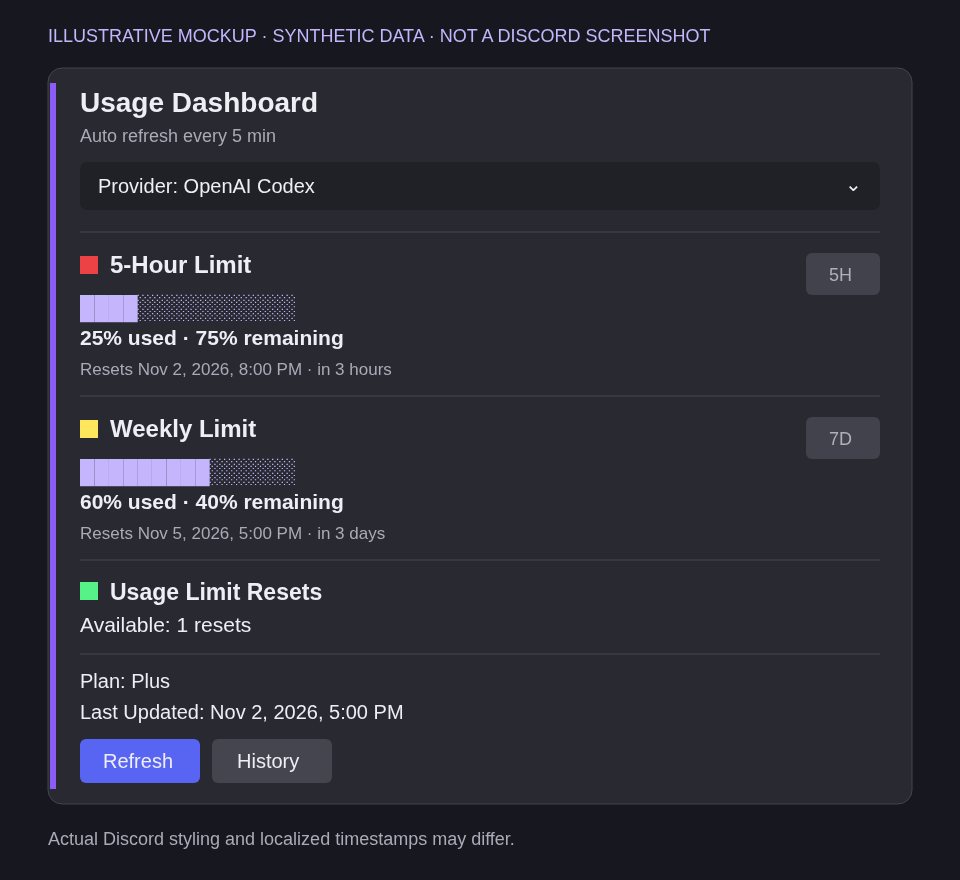
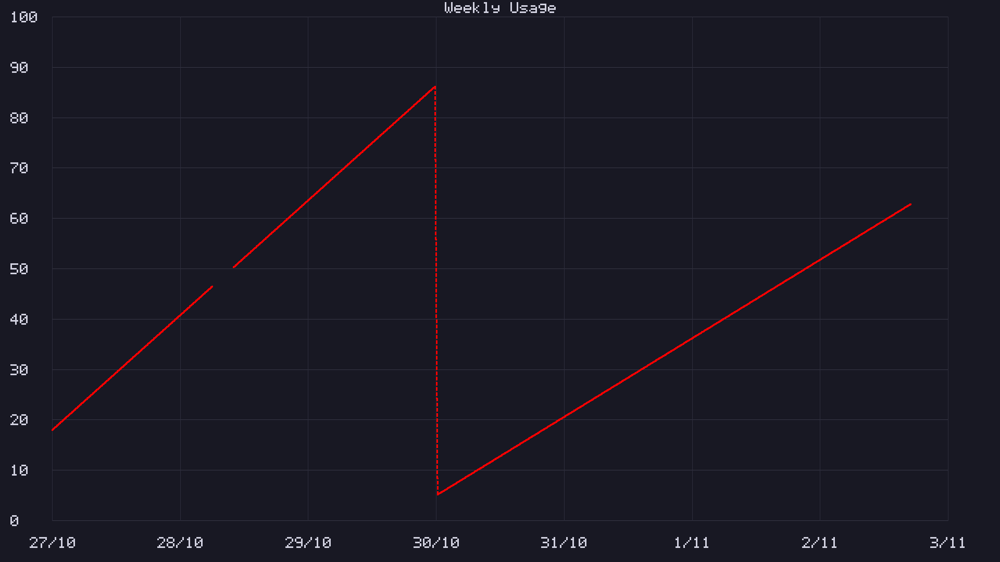

# Codex Usage Dashboard

[English](README.md) | **ภาษาไทย**

Dashboard แบบ self-hosted บน Discord Components V2 สำหรับดู usage ของ OpenAI Codex โดยอ่านข้อมูลผ่าน [Hermes Agent](https://github.com/NousResearch/hermes-agent) ที่ติดตั้งอยู่ แล้วอัปเดตข้อความที่ปักหมุดไว้ข้อความเดียว

## ภาพตัวอย่าง

### Dashboard หลัก



**ภาพจำลอง ไม่ใช่ screenshot จาก Discord** ค่าตัวเลขและวันที่ทั้งหมดเป็นข้อมูลสมมติ รูปแบบที่ Discord แสดงจริงและเวลาที่แปลตามผู้ใช้อาจต่างออกไป ตัวเลือก Provider ส่วน quota และปุ่ม Refresh/History อ้างอิง UI ปัจจุบัน

### ประวัติรายสัปดาห์



**ข้อมูลสมมติ เรนเดอร์ด้วย renderer จริงของโปรเจกต์** ไม่ใช่ประวัติบัญชีจริง ตัวอย่างแสดงช่วงข้อมูลขาดหาย เส้นประเชื่อมการ reset ที่ยืนยันด้วย metadata และพื้นที่อนาคตที่เว้นว่าง History แสดงเป็นข้อความส่วนตัวแบบ ephemeral พร้อมปุ่ม `← Previous 7 days` และ `Next 7 days →` ซึ่งไม่ได้รวมอยู่ในรูปกราฟนี้ ขอบเขตวันใช้ **Asia/Bangkok** ส่วนข้อความใน UI และกราฟยังเป็นภาษาอังกฤษ ไม่ว่าคู่มือจะเป็นภาษาใด

## ความสามารถ

- Dashboard แบบ native Discord Components V2 แสดง quota 5 ชั่วโมงและรายสัปดาห์
- มีตัวเลือก Provider เตรียมไว้สำหรับอนาคต ปัจจุบันเชื่อมต่อเฉพาะ OpenAI Codex
- Refresh เองได้โดยไม่มีข้อความตอบสำเร็จรบกวน และอัปเดตอัตโนมัติทุก 5 นาที
- ประวัติ 7 วันแบบ ephemeral ส่วนตัว เรนเดอร์ PNG ขนาด 1920×1080 ในเครื่องด้วยโค้ด deterministic
- เก็บประวัติใน SQLite แยกตาม provider และบัญชี มี logical retention 90 วัน
- ตรวจสิทธิ์ผู้ใช้ ช่อง และข้อความเป้าหมายอย่างเจาะจงก่อนรับ interaction
- Usage adapter เป็น read-only ไม่มี backend สำหรับ reset แลกเครดิต หรือ endpoint ที่ใช้เครดิต reset ใน public package นี้
- ไม่มีบริการกราฟภายนอก analytics หรือ telemetry

## สิ่งที่ต้องมี

- Linux หรือระบบอื่นที่รัน Node.js ต่อเนื่องได้
- Node.js 22.13 ขึ้นไป เพราะต้องใช้ `node:sqlite`
- คำสั่ง `hermes` ที่ใช้งานได้และเชื่อมบัญชี provider `openai-codex` แล้ว
- Discord application ที่มี bot
- ช่องข้อความปกติใน Discord server ไม่ใช่ thread

ตรวจแหล่งข้อมูลก่อนติดตั้ง:

```bash
hermes usage --provider openai-codex --json
```

การติดตั้ง Hermes และเชื่อมต่อ provider ดูได้ที่ <https://hermes-agent.nousresearch.com/docs/>

## ตั้งค่า Discord bot

1. สร้าง Discord application และ bot หรือใช้ bot ที่ Hermes เก็บ token ไว้อยู่แล้ว
2. เชิญ bot เข้า server ด้วย scope `bot`
3. ให้สิทธิ์ View Channel, Send Messages, Read Message History และ Pin Messages หรือ Manage Messages ในเวอร์ชันที่ใช้สิทธิ์นั้นสำหรับปักหมุด
4. เว้น **Interactions Endpoint URL** ของ application ให้ว่าง เพราะโปรเจกต์รับ interaction ผ่าน gateway
5. เปิด Discord Developer Mode แล้วคัดลอก Channel ID และ User ID ของผู้ใช้ทุกคนที่อนุญาตให้กดปุ่ม

Bot ใช้เฉพาะ gateway intent `Guilds` ไม่อ่านข้อความสนทนา

## ติดตั้ง

```bash
git clone https://github.com/bkt-cmyk/codex-usage-dashboard.git
cd codex-usage-dashboard
npm ci
cp .env.example .env
chmod 600 .env
```

แก้ `.env` ในเครื่อง ห้าม commit ไฟล์นี้ และห้ามวาง bot token ในแชต issue หรือ log

ตัวอย่างขั้นต่ำ ให้แทน placeholder ทั้งสองด้วย Discord ID ตัวเลขของคุณเอง:

```dotenv
DASHBOARD_CHANNEL_ID=YOUR_CHANNEL_ID
DASHBOARD_ALLOWED_USERS=YOUR_USER_ID
```

ค่าเริ่มต้นอ่าน bot token จาก `$HERMES_HOME/.env` หรือ `$HOME/.hermes/.env` หากใช้ bot แยก ให้ตั้ง `DISCORD_BOT_TOKEN` อย่างปลอดภัยใน `.env` ของ dashboard ห้ามใช้ข้อความ placeholder เป็นค่าจริง

### ตัวแปรตั้งค่า

- `DASHBOARD_CHANNEL_ID` — จำเป็น: ID ช่องข้อความปกติใน server
- `DASHBOARD_ALLOWED_USERS` — จำเป็น: User ID คั่นด้วย comma หรือช่องว่าง หากไม่มีรายชื่อจะไม่อนุญาตโดยปริยาย
- `DISCORD_BOT_TOKEN` — ไม่บังคับ: token โดยตรง หากไม่ตั้งจะอ่านจากไฟล์ environment ของ Hermes
- `HERMES_HOME` — ค่าเริ่มต้น `$HOME/.hermes` เปลี่ยนได้เมื่อใช้ Hermes profile อื่น
- `HERMES_ENV` — ค่าเริ่มต้น `$HERMES_HOME/.env`
- `HERMES_BIN` — ค่าเริ่มต้นคำสั่ง `hermes` จาก `PATH`
- `DASHBOARD_STATE_FILE` — ค่าเริ่มต้น `data/state.json`
- `DASHBOARD_HISTORY_FILE` — ค่าเริ่มต้นอยู่ข้างไฟล์ state

## ตรวจสอบก่อนสร้างข้อความบน Discord

```bash
npm test
hermes --run-module unittest discover -s test -p 'test*adapter.py'
npm audit --omit=dev
npm run check
```

`npm run check` ตรวจ usage จริงแบบ read-only รวมถึงการเชื่อมต่อและสิทธิ์ Discord หากอ่าน usage ไม่ได้หรือ bot ปักหมุดไม่ได้ จะจบด้วย exit code ที่ไม่ใช่ศูนย์ แสดงเฉพาะ readiness booleans/counts ที่ตัดข้อมูลละเอียดแล้ว ไม่สร้างหรือแก้ข้อความ Discord และไม่ใช้เครดิต reset

## สร้างข้อความ dashboard ครั้งแรก

มีเพียงคำสั่งนี้ที่สร้างและปักหมุดข้อความ Discord:

```bash
npm run publish
```

รันครั้งเดียวหลังตรวจช่องเป้าหมายและสิทธิ์การมองเห็น ระบบจะหยุดก่อนเขียน Discord หาก usage เริ่มต้นหรือสิทธิ์ปักหมุดไม่พร้อม และบันทึก pending publication marker ก่อนส่งเพื่อป้องกันการสร้างซ้ำเมื่อผลลัพธ์ไม่แน่นอน หากถูกขัดจังหวะแล้ว `data/state.json` มี `"publishing": true` ให้ตรวจช่องเป้าหมายว่ามีข้อความ dashboard ของ bot หรือไม่ก่อนทำอย่างอื่น หากมี ให้บันทึกและตรวจสอบ Message ID เพื่อแก้ state ด้วยตนเอง หากไม่มี ให้สำรองแล้วลบเฉพาะไฟล์ state ที่ค้างก่อนลองใหม่ ห้ามลองซ้ำโดยไม่ตรวจ

การเริ่มระบบปกติจะไม่สร้างข้อความทดแทนอัตโนมัติหากข้อความที่บันทึกไว้หายไป

## รัน

```bash
npm start
```

สำหรับ Linux ที่ต้องการรันต่อเนื่อง ให้คัดลอกและแก้ตัวอย่าง user service:

```bash
mkdir -p ~/.config/systemd/user
cp deploy/codex-usage-dashboard.service ~/.config/systemd/user/
systemctl --user daemon-reload
systemctl --user enable --now codex-usage-dashboard.service
systemctl --user status codex-usage-dashboard.service
```

ตัวอย่างสมมติว่า checkout อยู่ที่ `~/codex-usage-dashboard` และเพิ่ม `~/.local/bin` ใน `PATH` แล้ว หากติดตั้ง Node หรือ Hermes ผ่าน nvm ตัวจัดการเวอร์ชันอื่น หรือคนละตำแหน่ง ให้แก้ `WorkingDirectory`, `ExecStart`, `PATH` และ `HERMES_BIN` ตรวจค่าที่ service ใช้ด้วย `systemctl --user show codex-usage-dashboard.service -p Environment -p ExecStart` หากต้องการทำงานหลัง logout ผู้ดูแลระบบอาจต้องเปิด lingering ด้วย `loginctl enable-linger "$USER"`

## ข้อมูลและความเป็นส่วนตัว

- Git ignore `.env`, `data/`, logs, SQLite และภาพ preview ที่สร้างในพื้นที่ข้อมูลส่วนตัวอยู่แล้ว ส่วนรูปตัวอย่างที่ตั้งใจเผยแพร่ใน `docs/previews/` จะอยู่ใน repo
- State, usage ล่าสุด และประวัติถูกเขียนด้วยสิทธิ์ส่วนตัวภายใต้ umask ของ process
- ประวัติเก็บ effective-account fingerprint แบบ opaque, timestamps, reset anchors และเปอร์เซ็นต์ usage รายสัปดาห์ดิบ ไม่เก็บ token หรือ account ID
- History เป็น ephemeral และผูกกับผู้ขอ provider บัญชี ช่อง และ reply ที่เจาะจง
- ใครเห็น dashboard หลักขึ้นกับสิทธิ์ช่อง Discord การจำกัดคนกดปุ่ม **ไม่ได้ทำให้ช่องสาธารณะกลายเป็นส่วนตัว**
- SQLite retention เป็นการลบเชิงตรรกะ ไม่รับประกัน secure erasure

## ข้อกำหนดด้านความปลอดภัย

- อ่าน usage ด้วยการ resolve credentials แบบ `read_only=True` และ `refresh_if_expiring=False`
- Refresh, startup, check และ history ไม่เรียก endpoint สำหรับ reset หรือแลกเครดิต
- Adapter ส่งออกเฉพาะ normalized document ไม่ส่ง raw provider response, credentials หรือ identities
- Public package ไม่รวม backend manual reset ที่ไม่ได้ใช้งานใน deployment เดิม
- ปิด allowed mentions และตัดรายละเอียดอ่อนไหวจากข้อความ error ใน log

## พัฒนาและทดสอบ

```bash
npm ci
npm test
hermes --run-module unittest discover -s test -p 'test*adapter.py'
npm audit --omit=dev
```

Node tests ใช้ฐานข้อมูลชั่วคราวแยกและ mock Discord ส่วน Python adapter tests mock การเข้าถึงเครือข่ายและ credentials ไม่มี test ใดสร้างข้อความ Discord หรือขอ reset จริง

## ข้อจำกัดและการจัดการ service

- เชื่อม usage ได้เฉพาะ OpenAI Codex ตัวเลือก Claude และ Gemini เป็น Coming soon ยังใช้งานไม่ได้
- History แสดงช่วง 7 วันปฏิทินตาม Asia/Bangkok ไม่ใช่เขตเวลาของผู้เปิดดู
- ติดตั้งใหม่จะยังไม่มีประวัติ ระบบไม่เติมข้อมูลสมมติย้อนหลังลงประวัติจริง
- API ภายในของ Hermes ที่ adapter ใช้อาจเปลี่ยนได้ ให้รัน read-only check หลังอัปเดต Hermes โปรเจกต์นี้ไม่แก้หรือรีสตาร์ต Hermes gateway
- ไม่มี GitHub Actions workflow ให้รัน local tests ตามคู่มือนี้

```bash
systemctl --user stop codex-usage-dashboard.service
systemctl --user start codex-usage-dashboard.service
systemctl --user restart codex-usage-dashboard.service
systemctl --user status codex-usage-dashboard.service --no-pager
journalctl --user -u codex-usage-dashboard.service -f
```

สิทธิ์อ่าน journal ขึ้นกับเครื่อง หลังแก้ config ให้รีสตาร์ตเฉพาะ dashboard นี้ อย่าเปลี่ยน channel โดยยังใช้ state ของช่องอื่น และให้มีเพียง instance เดียวต่อ state file

## License

MIT — ดู [LICENSE](LICENSE)
